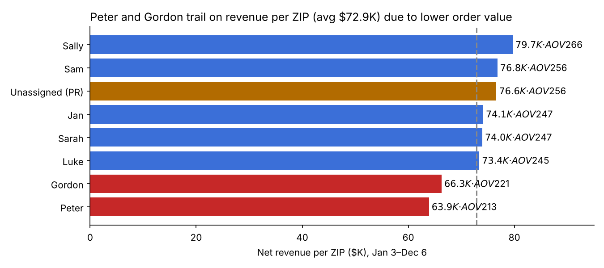
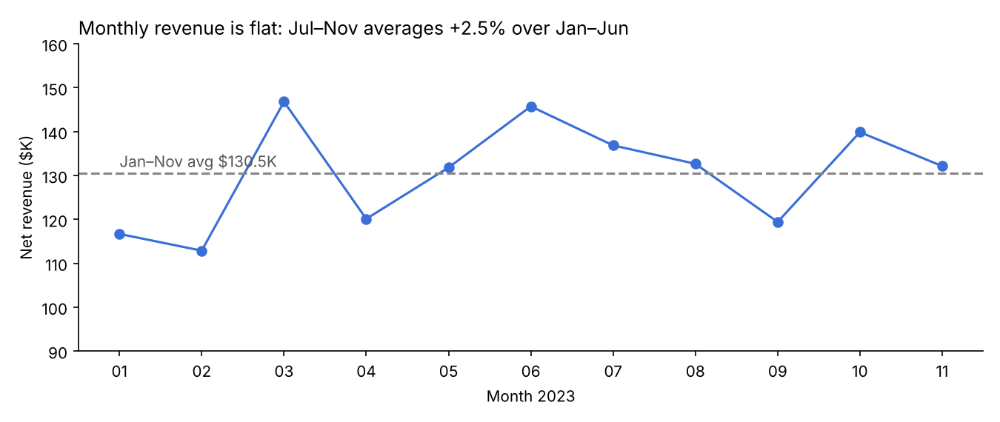
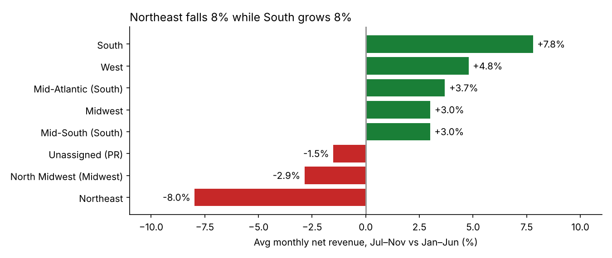

# Sales review 2023: director and manager dashboards

**Dashboard (Director and Manager tabs):** https://claude.ai/artifact/XppKv6XHCvJ6imBXC85Jbp

## 1. Question

How did sales perform from 3 Jan to 6 Dec 2023, and what should a **sales director** (strategy: totals, trend, regions, mix) and a **sales manager** (operations: agents, teams, ZIP territories, weeks) track to make decisions? *(Inferred from the Task sheet; the decision it informs is where to put management attention and territory ownership.)*

## 2. Answer

Net revenue was **$1,457,538** from **5,991 orders** (AOV **$243.29**). Sales are **flat, not growing**: full months averaged $132,195 in Jul–Nov against $129,009 in Jan–Jun (**+2.5%**), and November ($132,139) is +1.1% on the Aug–Oct average. The differences that matter are below the total: two agents (Peter, Gordon) bring 9–12% less revenue per ZIP than average because their orders are smaller, the Northeast is the only large region falling (−8%), and **$76,608 (5.3%) of revenue comes from a ZIP with no agent** (Puerto Rico, 00965).

## 3. Findings

### 3.1 Agent totals reflect territory count; revenue per ZIP shows real performance
Every ZIP carries 299–300 orders, so Jan's 30.5% share of revenue comes from covering 6 of 20 ZIPs. Per ZIP, the company average is **$72,877**. Sally leads at $79,691 (1 ZIP, AOV $265.64); **Peter is lowest at $63,897 (−12.3%, AOV $212.99, 2 ZIPs, 600 orders)** and **Gordon $66,281 (−9.1%, AOV $221.30, 2 ZIPs, 599 orders)**. Order counts are the same, so the gap is order value. At the company AOV their orders would have been worth about $18,180 (Peter) and $13,170 (Gordon) more; this is arithmetic, not a forecast, and the data cannot say why their orders are smaller (client mix, pricing or services sold).
**So what:** compare agents on revenue per ZIP and AOV, not totals; review Peter's and Gordon's service mix (their mix view is on the Manager tab).

### 3.2 Revenue is flat; Northeast declines while South grows
Monthly net revenue ranged from $112,875 (Feb) to $146,808 (Mar) with no trend (chart 1). By region, average monthly revenue Jul–Nov vs Jan–Jun: **Northeast −8.0%** ($13,510 → $12,433 per month, 600 orders, both ZIPs down: NY −9.9%, MA −5.9%), North Midwest −2.9% (1 ZIP), South +7.8%, West +4.8%, Mid-Atlantic +3.7%, Midwest +3.0%, Mid-South +3.0%. Jan (Midwest, 6 ZIPs) had a weak November: −12.1% against his Aug–Oct average, the largest drop of any agent.
**So what:** the director's first follow-ups are Northeast (Luke) and Jan's November dip; with about 27 orders per ZIP per month, one month can swing, so watch December before acting.

### 3.3 Three categories make 60% of revenue; Boarding drives growth, Grooming and Surgery slip
Professional Services (22.9%), Laboratory (20.0%) and Pharmacy (17.1%) bring 59.97% of net revenue. Boarding (11.2%, 678 lines) grew **+22.6%**, adding about **$3,003 per month**, the largest gain of any category. Grooming fell −5.8% (−$1,107/month, 1,879 lines). Surgery fell −45.9% but has only 130 lines, so treat it as noise until confirmed. Discounts and returns are 1.04% of gross ($15,295), but November reached $2,870 (2.1% of gross), 2.4× the Jan–Oct monthly average of $1,200.
**So what:** protect the three core categories, push Boarding capacity, check the November discount spike (highest rates: Gordon 1.33%, ZIP 50667 2.2%, ZIP 98042 2.0%).

## 4. What was done

- **Profile** (`docs/profile.md`): 3 data sheets, 13,496 order lines × 5 columns, 20 ZIPs, 7 agents. Grain of Orders = one revenue-category line of one order (key ORDER_ID + ORDER_CATEGORY, 13,496 unique; 5,991 orders). 0 duplicates.
- **Clean** (`docs/cleaning-log.md`, `work/01_clean.sql`): 12 logged steps, **0 rows removed** (13,496 → 13,496). Fixed agent ID type (join went from 0 to 19 of 19 ZIPs matched), team name case (7 → 5 teams), trailing spaces in agent regions, lost ZIP leading zeros; labelled the PR ZIP "Unassigned (PR)"; flagged 121 refund lines, 2,367 zero lines, 246 outliers and partial December, all kept.
- **Validate** (`docs/validation.md`, `work/03_validate.sql`): **34 of 34 checks pass**, including revenue reconciled to the cent ($1,457,538.49 raw = clean), row counts unchanged by joins, and net revenue, orders, gross revenue, per-agent and monthly figures recomputed independently in pandas.
- **Marts** (`work/02_marts.sql`): 11 SQL views feed the dashboard: `dir_kpis`, `dir_monthly`, `dir_macro_region_month`, `dir_region`, `dir_category` (director); `mgr_agent`, `mgr_agent_month`, `mgr_agent_category`, `mgr_zip`, `mgr_agent_week`, `mgr_team` (manager). An order-grain view `v_orders` is built once so AOV and order counts never double count lines.
- **Dashboard:** Director tab = 6 KPI tiles, monthly trend, region totals and per-ZIP, region change, category mix, region scorecard, decision note. Manager tab = agent picker, agent tiles vs company, revenue per ZIP by agent, agent scorecard (click a row to select), monthly and 12-week trends per ZIP vs company, category mix vs company, ZIP table.

## 5. Caveats and assumptions

| Assumption / caveat | Default used | Effect under the alternative |
|---|---|---|
| Revenue = **net** (incl. "Fee Discounts & Client Returns") | Net $1,457,538 | Gross is $1,472,834 (+1.0%); no ranking changes |
| ZIP 00965 (PR) has no region/agent | Shown as "Unassigned (PR)" | If it belongs to an agent, that agent's total rises by $76,608 and their per-ZIP figure moves toward $76,608 |
| December 2023 is partial (4 trading days) | Left out of monthly comparisons | Including it as a month would show a false −83% drop |
| Refunds (121 lines, −$12,937) and outliers (246 lines, $114,557) | Kept, flagged | Dropping refunds: +0.9%; dropping outliers: −7.9% of revenue |
| Format | One Claude dashboard with a Director and a Manager tab; SQL in SQLite (standard SQL, ports to Postgres/SQL Server/Snowflake with small function renames) | — |
| Comparisons | No targets, budgets or prior year in the data, so baselines are company averages and earlier months | With targets, attainment % would replace per-ZIP comparison |
| Small groups | Sally, North Midwest and PR are 1 ZIP (~300 orders); weekly figures per ZIP are ~6 orders | Weekly and single-ZIP swings should not drive decisions alone |

The dashboard reads fixed CSV snapshots of the SQL views; to refresh, rerun `work/run_pipeline.py` and re-upload, or point the dashboard at the warehouse tables these views run on.

## 6. Recommendations

1. Assign an owner to ZIP 00965 (Puerto Rico): it earns about as much as an average ZIP ($76,608) with nobody accountable.
2. Manage agents on revenue per ZIP and AOV; start with Peter and Gordon's service mix and pricing.
3. Investigate the Northeast decline and Jan's November drop; confirm with December data.
4. Review the November discount spike and grow Boarding.
5. Add targets and prior-year data so both dashboards can show attainment and year-on-year change.

## 7. Data and files

Source: `raw/sales_data_2023.xlsx` (Orders 13,496 rows, Regions 20, Sales_agents 7; unchanged, SHA-256 checked). Tools: Python 3 + pandas, SQLite 3.53, matplotlib, Claude dashboard (d3).
- `docs/profile.md`, `docs/cleaning-log.md`, `docs/validation.md`
- `work/01_clean.sql`, `work/02_marts.sql`, `work/03_validate.sql`, `work/run_pipeline.py`, `work/sales.sqlite`
- `clean/` cleaned tables (`clean_orders`, `clean_regions`, `clean_sales_agents`, `fact_order_lines`), view extracts as CSV and `marts.xlsx`
- `charts/` three report charts
